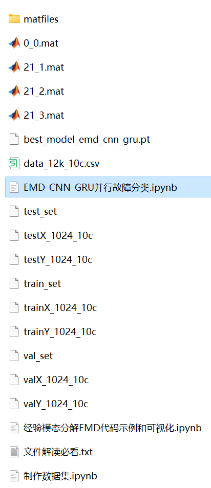
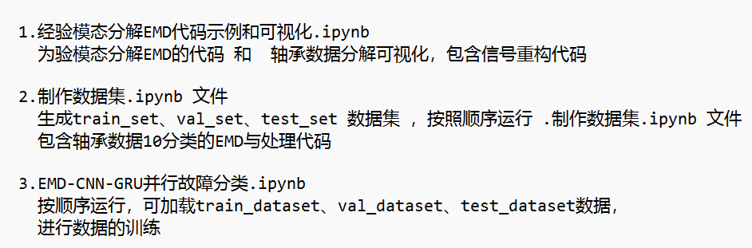

# EMD-CNN-GRU Parallel Bearing Fault Classification Model

Including a complete bearing fault dataset, as well as the fault signal dataset, classification data, and label set that have been generated and preprocessed through EMD decomposition. The corresponding codes can be run, and there are also examples of EMD decomposition.
50 epochs, nearly 96% accuracy. The EMD-CNN-GRU parallel network classification effect is significant. The CNN-GRU parallel model can fully extract the spatial and temporal features of bearing fault signals, has a fast convergence speed and excellent performance.
Includes the code for data EMD preprocessing and the parallel classification code of EMD-CNN-GRU.
Environment: Python 3.9
\n        \n  
  
  

## Images

<!-- PAYMENT_BLOCK -->

## Get this dataset

- Payment link (Stripe): [Buy now](https://buy.stripe.com/3cs8yP7sY87d0vu9AB)
- Payment QR code: 

<!-- /PAYMENT_BLOCK -->
